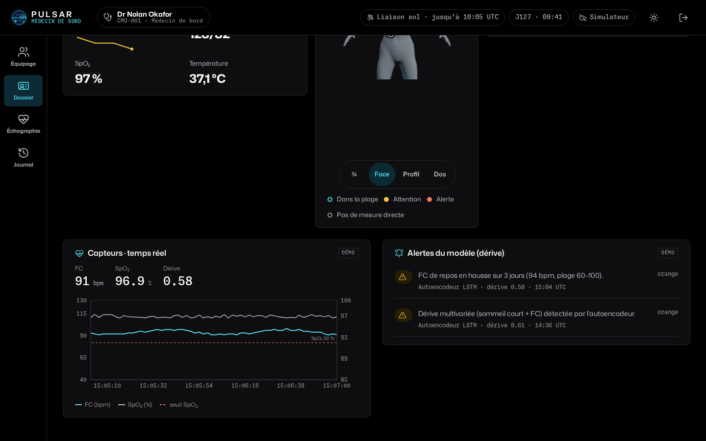

# PULSAR AHM — Astronaut Health Monitoring

NASA Space Apps 2026 · health monitoring for astronauts on long-duration missions.
Three dashboards, one per role, plus a watch:

| Role | Device | Dashboard |
|---|---|---|
| **Astronaut** | personal tablet + watch + kits | `/astronaute` — their own data only |
| **Crew surgeon** | medical tablet / sickbay display + ultrasound probe | `/medecin-bord` — the whole crew |
| **NASA physicians (Houston)** | Mission Control Center workstations | `/nasa` — reports received over the satellite link |

The app opens on a **public home page** (`/`: what PULSAR is, HRP hazards, how data moves, an interactive demo). “Sign in” leads to the **single sign-in screen** `/connexion` (logo, short mission intro, a photo of Earth from the ISS, the form). Each person enters **their personal identifier** and code. The role is inferred from the identifier (`AST-…`, `CMO-…`, `NASA-FS-…`) and they land on their own dashboard. There is **no “Choose a profile” screen and no account list** in the interface.

This repository holds the **front end** (`frontend/`) and the **ship server** (`backend/`, FastAPI). Heart-rate forecasts are computed by **XGBoost, an LSTM, and Prophet** on the demo series (`GET /predictions/{id}` and `GET /heart-rate/live`). The other metrics stay a demo scenario. This is decision support, not a diagnosis. If the API does not answer, the front end falls back to its simulator. The NASA key never reaches the browser: the space-weather card calls `GET /reference/space-weather`.

### Status on 15 November 2026

- **Temperature (°C) and mood (1 to 5)** are entered in Kits (`/astronaute/kits`), with a Nominal / Caution / Warning lamp, the action to take, who is notified, and a line in the device log.
- **Thresholds** live in `frontend/src/data/thresholds.ts`. Forecast blood pressure (was 135/150) matches 130/160. Home-screen pulse (was 90/110) matches 100/120. Fasting glucose follows 70–99. Glucose forecasts stay on the high side (126/180) because they have no meal context.
- **Heart rate** is forecast by XGBoost, LSTM, and Prophet (observed line, three dashed forecasts, model interval). The other indicators remain a demo scenario.
- **French and English**: the FR | EN switch covers the dashboards. Medical values on screen are still demo data.
- **Ship server**: `cd backend && python -m app.seed && uvicorn app.main:app --port 8000`. Demo keys `demo-key-watch-lk`, `demo-key-kit-lk`, `demo-key-cmo` (SHA-256 hash only). The front end sends `X-User-Id` from the open session, never an API key.
- **Space weather**: a card on the watch and on the crew-surgeon board. Source is Connected, Cache, or Offline. DONKI reference, not a crew measurement.
- **Offline**: fonts, scripts, and icons are local (no CDN). The production build does not call the Internet.

### What is in the app

- **Forecasts and proposed actions**: observed vs predicted curves (24 h / 7 d) with a confidence interval for heart rate, SpO₂, blood pressure, temperature, glucose, sleep, and radiation; drift score, risk level, time to threshold; anomalies with contributing signals; non-diagnostic actions (Apply / Mark done / Escalate; the crew surgeon validates or replaces). A summary is attached to NASA reports.
- **Cooperative gamification** (CDC § 5.9, EF-42/43/44): regularity streaks and badges, daily missions, a crew goal with no ranking, switchable off in Settings; a watch complication; the crew surgeon sees participation only.
- **Dense telemetry**: time window (live / fixed), latest-value table (LAD), inspector — PULSAR layout (not an Open MCT frame).
- **Workflow** New · Seen · In progress · Resolved · Escalated, plus an owner, on alerts, actions, and reports.
- **Watch**: pairing card at the top of the astronaut dashboard; the section stays inactive without a watch.
- **Alarm sounds** follow IEC 60601-1-8 (no chrome icon); a red alarm can be paused for 2 minutes only after it has been seen.


---

## 1. Install and run

Requirements: **Node.js 20.19 or newer** (https://nodejs.org, LTS) and Cursor. The ship server needs **Python 3.12**.

Front end (PowerShell):

```powershell
cd D:\PULSAR-PROJECT\frontend
npm i
npm run dev
```

Open http://localhost:5173 for the home page and sign-in screen.

Ship server, in a second terminal:

```powershell
cd D:\PULSAR-PROJECT\backend
python -m pip install -r requirements.txt
python -m app.seed
python -m uvicorn app.main:app --port 8000
```

Environment (optional): copy `frontend/.env.example` to `frontend/.env` and edit it.

| Variable | Default | Role |
|---|---|---|
| `VITE_API_URL` | `http://localhost:8000` | FastAPI base URL |
| `VITE_USE_MOCK` | `false` | `true` = local simulator only (otherwise the simulator starts automatically if the API is unreachable) |
| `VITE_AUTH_API_URL` | empty | empty = demo accounts; a URL = real authentication API |
| `VITE_DEV_TOOLS` | empty | dev pages inside a production build |

Other commands (from `frontend/`):

| Command | Role |
|---|---|
| `npm run typecheck` | TypeScript check |
| `npm run build` then `npm run preview` | production build (http://localhost:4173) |
| `npm run test:e2e:install` (once) then `npm run test:e2e` | Playwright: sign-in with each identifier, guards, errors |

## 2. Demo identifiers

| Identifier | Code | Role | Name |
|---|---|---|---|
| `AST-001` | `482105` | Astronaut | Lina Kovacs |
| `AST-002` | `130742` | Astronaut | Alex Morgan |
| `AST-003` | `559031` | Astronaut | Nolan Okafor |
| `AST-004` | `246813` | Astronaut | Sofia Reyes |
| `CMO-001` | `731406` | Crew surgeon | Dr Nolan Okafor |
| `NASA-FS-001` | `905218` | NASA Houston (flight surgeon) | Dr Maya Chen |
| `NASA-FS-002` | `618847` | NASA Houston (flight surgeon) | Dr Daniel Brooks |

These accounts are **not listed in the interface**. They are documented here and in `docs/ROLES-ET-IDENTIFIANTS.md` only.
**Demo only**: authentication is simulated in the browser. Rules: [`docs/ROLES-ET-IDENTIFIANTS.md`](docs/ROLES-ET-IDENTIFIANTS.md).
To connect a real server: `frontend/src/features/auth/authService.ts` (`HttpAuthService`) plus `VITE_AUTH_API_URL` (see `frontend/.env.example`).

## 3. Connect Figma to Cursor (MCP)

The reference design is the Figma file **PULSAR AHM — v6**:
https://www.figma.com/design/cj96CiSofo2y0mDSpre7J1

The project already includes `.cursor/mcp.json` (official Figma MCP server, `https://mcp.figma.com/mcp`). You still need to **sign in once**:

1. Open the folder `D:\PULSAR-PROJECT` in Cursor (*File › Open Folder*).
2. *Cursor Settings* (Ctrl+Shift+J) › **Tools & MCP**. The **figma** server appears in the list (otherwise: *Add custom MCP* and paste `.cursor/mcp.json`).
3. Click **Connect** next to *figma* → a Figma page opens → **Allow access** (with a Figma account that can open the file).
4. The status turns green. In Cursor chat, try: “With the Figma MCP, call get_design_context on node 34:5 of file cj96CiSofo2y0mDSpre7J1”.

Figma’s recommended option: in Cursor chat, type `/add-plugin figma` (this also installs the Figma skills), then *Tools & MCP › Connect*.

Cursor then knows the project through:
- `.cursor/rules/design-system.mdc` (always on): tokens, fonts, icons, status colors, themes, banned effects;
- `.cursor/rules/project.mdc` (always on): architecture, roles, authentication, commands;
- `.cursor/rules/figma.mdc`: Figma links, the node for each screen, the `get_design_context` method;
- `AGENTS.md`: a short brief for any AI agent.

Example request: *“Improve screen A04 Kits from Figma node 34:17, and keep our tokens.”*

## 4. Live data and the backend

- `frontend/src/api/`: typed client (`fetch`, base `VITE_API_URL`), types `Astronaut`, `TelemetrySample`, `Alert` (level `vert` / `orange` / `rouge`, `driftScore`), a **mock** adapter, and **React Query** hooks: `useTelemetry` (every 2 s), `useAlerts` (15 s), `useAstronauts` (30 s), `useDataSource`, `useHeartForecast`.
- If `VITE_USE_MOCK=true` **or** the API does not answer, the simulator takes over (“Simulator” chip, DEMO tags) and the API is retried every 30 s.
- **Recharts** curves: heart rate + SpO₂, and radiation (dose rate + cumulative), on the astronaut watch screen and in each crew file on the crew-surgeon side. The live heart-rate chart continues the trace with XGBoost, LSTM, and Prophet.
- JSON contract: [`docs/API-CONTRACT.md`](docs/API-CONTRACT.md). Ship server: [`backend/README.md`](backend/README.md).



## 5. Repository layout

```
PULSAR-PROJECT/
├─ README.md                 ← this file
├─ AGENTS.md                 ← instructions for AI agents (Cursor)
├─ .cursor/
│  ├─ mcp.json               ← Figma MCP server
│  └─ rules/                 ← design-system.mdc · figma.mdc · project.mdc
├─ backend/                  ← FastAPI ship server (forecasts, telemetry, sync)
├─ docs/
│  ├─ API-CONTRACT.md        ← JSON contract between front end and backend
│  ├─ DESIGN.md              ← each screen: Figma node, prototype, route, capture
│  ├─ ROLES-ET-IDENTIFIANTS.md
│  ├─ CDC-PULSAR-v2.pdf      ← requirements
│  └─ screens/               ← reference captures (hero, screens, sign-in)
└─ frontend/
   ├─ public/                ← fonts, logos, NASA photo, 3D model (body3d/body.glb + LICENSE.md)
   ├─ .env.example           ← VITE_API_URL, VITE_USE_MOCK, VITE_AUTH_API_URL
   ├─ tests/                 ← Playwright: smoke.spec.ts, features.spec.ts, sound.spec.ts
   └─ src/
      ├─ app/                ← router, shared role shell, dev pages
      ├─ api/                ← typed API client, mock, React Query hooks
      ├─ features/
      │  ├─ landing/         ← public home page (/)
      │  ├─ auth/            ← sign-in (/connexion), session, route guards, auth service
      │  ├─ astronaute/      ← A01–A12
      │  ├─ medecin-bord/    ← M01–M11 (guided ultrasound)
      │  ├─ nasa/            ← N01–N06
      │  ├─ montre/          ← square watch 198×242 and round watch 454×454
      │  ├─ predictions/     ← forecasts, anomalies, proposed actions, inspector
      │  ├─ gamification/    ← streaks, badges, missions, crew goal (CDC § 5.9)
      │  └─ sound/           ← sounds and alarms (Web Audio, IEC 60601-1-8)
      ├─ components/
      │  ├─ ui/              ← shared components (lucide Icon, Card, Lamp, Demo…)
      │  ├─ charts/          ← live Recharts curves (HR, SpO₂, radiation)
      │  ├─ telemetry/       ← time conductor + LAD table
      │  └─ body3d/          ← 3D health silhouette (three.js, MakeHuman CC0)
      ├─ design/             ← tokens.css · tokens.ts · figma-map.ts
      ├─ data/               ← types + demo data (crew, zones, users)
      └─ styles/             ← screen styles
```

Stack: React 19 · Vite 8 · TypeScript strict · Tailwind CSS 4 (wired to the tokens) · TanStack React Query · Recharts · lucide-react · Motion · three.js / react-three-fiber · react-router · Playwright. Ship server: FastAPI.

## 6. Git

Remote: https://github.com/kevinleboss499-code/PULSAR.git

Active development is on `kevin/pulsar`. `michel/pulsar` keeps the earlier front-end documents commit.

`.gitignore` already excludes `node_modules`, `dist`, test reports, `.env`, and Python bytecode (`__pycache__`, `*.pyc`).

## Credits
- Fonts: Space Grotesk and IBM Plex (SIL OFL 1.1) · lucide icons (ISC) · Recharts (MIT).
- 3D silhouette: MakeHuman “base.obj” mesh, CC0 1.0 (`frontend/public/body3d/LICENSE.md`).
- Photos: NASA (public domain).
- Design inspiration: NASA Open MCT (Apache-2.0, © 2014-2024 United States Government / NASA) — principles only, no copied code.
- Sounds: synthesized in the browser (Web Audio), no audio files.
- Every medical value on screen is **fictional (DEMO)**.
