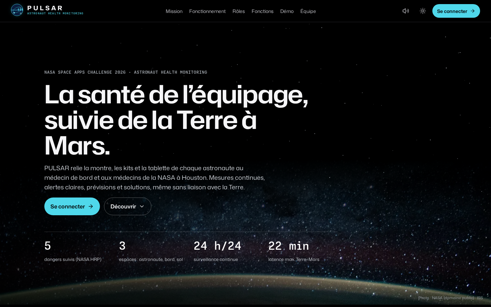
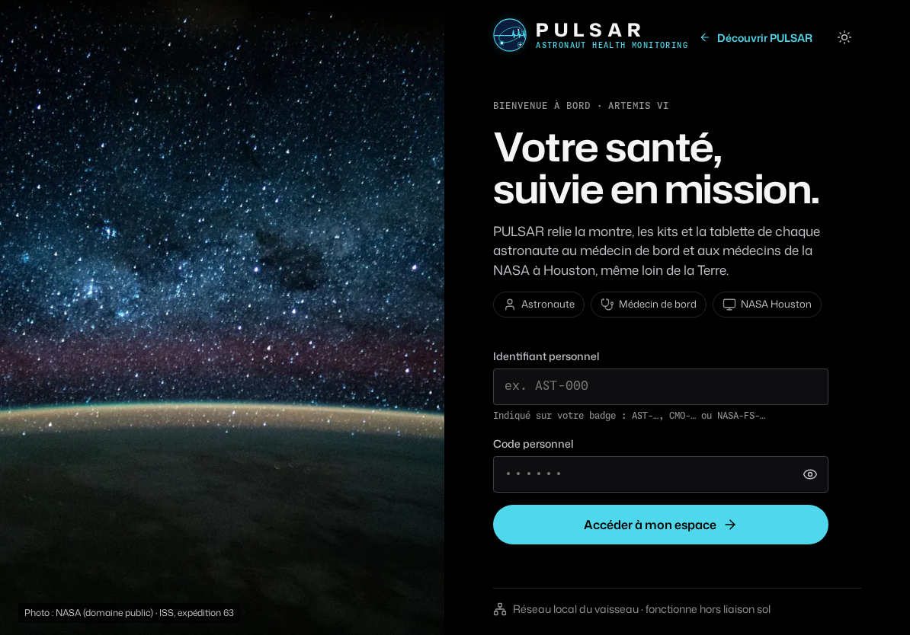
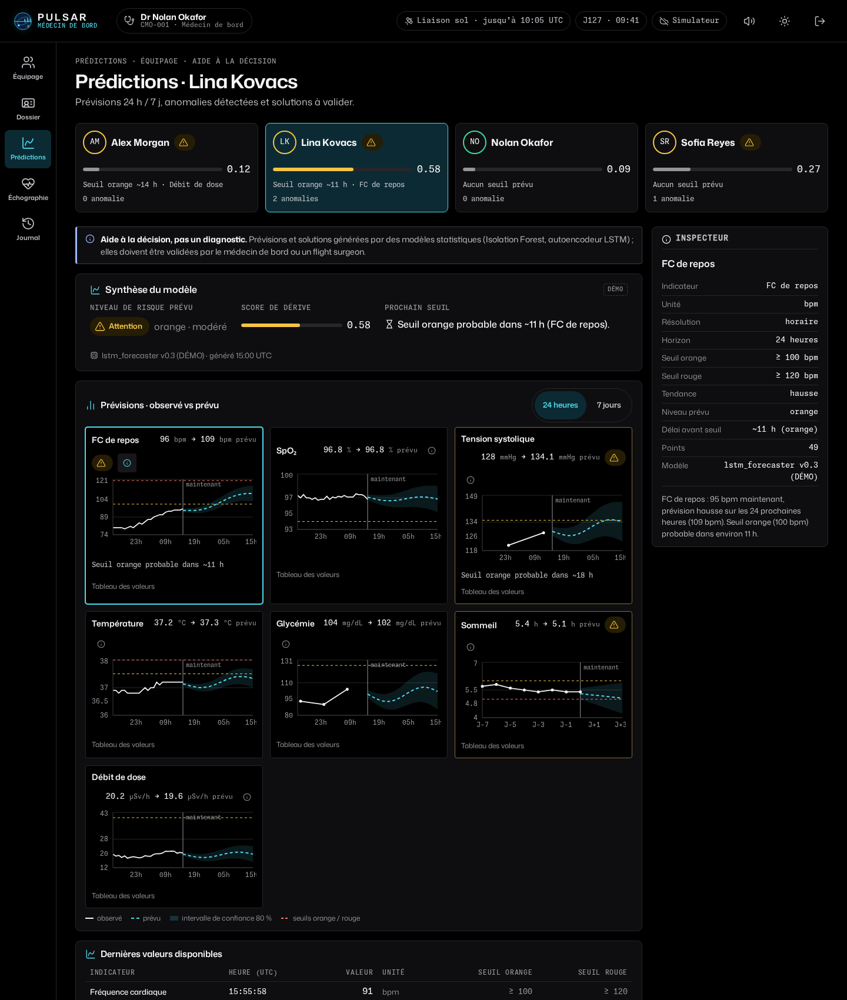

# PULSAR AHM — Astronaut Health Monitoring (front-end v6)

Projet NASA Space Apps 2026 · suivi de santé des astronautes en mission longue.
Trois tableaux de bord, un par rôle, et une montre :

| Rôle | Appareil | Tableau de bord |
|---|---|---|
| **Astronaute** | tablette personnelle + montre + kits | `/astronaute` — ses propres données uniquement |
| **Médecin de bord** | tablette médicale / écran d’infirmerie + sonde d’échographie | `/medecin-bord` — tout l’équipage |
| **Médecins NASA (Houston)** | postes du Mission Control Center | `/nasa` — rapports reçus par satellite |

L’application s’ouvre sur une **page d’accueil publique** (`/` : présentation de PULSAR, dangers HRP, parcours des données, démo interactive) ; le bouton « Se connecter » mène à **l’écran de connexion unique** `/connexion` (logo, présentation courte, photo de la Terre vue de l’ISS, formulaire). Chaque utilisateur saisit **son identifiant personnel** et son code : le rôle est déduit de l’identifiant (`AST-…`, `CMO-…`, `NASA-FS-…`) et il arrive directement sur son tableau de bord. Il n’y a **ni écran « Choix du profil » ni liste de comptes** dans l’interface.

Ce dépôt contient le **front-end** (`frontend/`) et le **serveur de bord** (`backend/`, FastAPI). Les prévisions restent simulées. Si l’API ne répond pas, le front revient à son simulateur. La clé NASA n’est jamais dans le navigateur : la carte météo appelle `GET /reference/space-weather`.

### État au 15 novembre 2026

- **Température (°C) et humeur (1 à 5)** se saisissent dans Kits (`/astronaute/kits`), avec voyant Nominal / Attention / Alerte, l’action à faire, la personne prévenue, et une ligne dans le journal de l’appareil.
- **Seuils** centralisés dans `frontend/src/data/thresholds.ts`. La tension des prévisions (135/150) est alignée sur 130/160. Le pouls de l’accueil (90/110) est aligné sur 100/120. La glycémie à jeun suit 70–99. Les prévisions de glycémie restent sur le côté haut (126/180) parce qu’elles n’ont pas le contexte repas.
- **Prévisions, Isolation Forest et LSTM** sont étiquetés **SIMULÉ** : aucun modèle réel ne tourne.
- **Anglais** : titres des trois tableaux de bord (état du jour, surveillance équipage, titres de rapports NASA) via le sélecteur FR | EN. Le reste des écrans reste en français.
- **Serveur de bord** : `cd backend && python -m app.seed && uvicorn app.main:app --port 8000`. Clés factices `demo-key-watch-lk`, `demo-key-kit-lk`, `demo-key-cmo` (empreinte SHA-256). Le front envoie `X-User-Id` depuis la session déjà ouverte, jamais une clé d’API.
- **Météo spatiale** : carte sur la montre et le tableau du médecin. Provenance Connecté, Cache ou Hors ligne. Référence DONKI, pas une mesure d’équipage.
- **Hors-ligne** : polices, scripts et icônes sont locaux (pas de CDN). Le build n’appelle pas Internet.

### Nouveautés

- **Prédictions et solutions proposées** : courbes prévu vs observé (24 h / 7 j) avec intervalle de confiance pour FC, SpO₂, tension, température, glycémie, sommeil et rayonnement ; score de dérive, niveau de risque, délai avant seuil ; anomalies avec signaux contributeurs ; solutions non diagnostiques (Appliquer / Marquer fait / Escalader ; le médecin de bord valide ou remplace). Synthèse dans les rapports NASA.
- **Gamification coopérative** (CDC § 5.9, EF-42/43/44) : séries et badges de régularité, missions du jour, objectif d’équipage sans classement, désactivable dans Réglages ; complication sur la montre ; le médecin ne voit que la participation.
- **Télémétrie dense** : fenêtre temps (temps réel / fixe), tableau des dernières valeurs (LAD), inspecteur — design PULSAR (sans cadrage Open MCT).
- **Workflow** Nouveau · Vu · Pris en charge · Résolu · Escaladé + responsable sur alertes, solutions et rapports.
- **Montre** : carte appairage (scan stub) en tête du dashboard ; section inactive sans montre.
- **Sons d’alarme** IEC 60601-1-8 (pas d’icône chrome) ; pause rouge 2 min seulement après lecture.







---

## 1. Installer et lancer

Prérequis : **Node.js 20.19 ou plus récent** (https://nodejs.org, version LTS) et Cursor.

Dans un terminal (PowerShell) :

```powershell
cd D:\PULSAR-PROJECT\frontend
npm i
npm run dev
```

Ouvrir http://localhost:5173 → écran d’accueil et de connexion.

Variables d’environnement (facultatif) : copier `frontend/.env.example` en `frontend/.env` puis adapter.

| Variable | Défaut | Rôle |
|---|---|---|
| `VITE_API_URL` | `http://localhost:8000` | URL du backend FastAPI |
| `VITE_USE_MOCK` | `false` | `true` = simulateur local uniquement (sinon simulateur automatique si l’API est injoignable) |
| `VITE_AUTH_API_URL` | vide | vide = comptes de démo ; URL = vraie API d’authentification |
| `VITE_DEV_TOOLS` | vide | pages de dev dans un build de production |

Autres commandes (dans `frontend/`) :

| Commande | Rôle |
|---|---|
| `npm run typecheck` | vérification TypeScript |
| `npm run build` puis `npm run preview` | version de production (http://localhost:4173) |
| `npm run test:e2e:install` (une fois) puis `npm run test:e2e` | tests Playwright : connexion avec chaque identifiant, gardes, erreurs |

## 2. Identifiants de démonstration

| Identifiant | Code | Rôle | Nom |
|---|---|---|---|
| `AST-001` | `482105` | Astronaute | Lina Kovacs |
| `AST-002` | `130742` | Astronaute | Alex Morgan |
| `AST-003` | `559031` | Astronaute | Nolan Okafor |
| `AST-004` | `246813` | Astronaute | Sofia Reyes |
| `CMO-001` | `731406` | Médecin de bord | Dr Nolan Okafor |
| `NASA-FS-001` | `905218` | NASA Houston (flight surgeon) | Dr Maya Chen |
| `NASA-FS-002` | `618847` | NASA Houston (flight surgeon) | Dr Daniel Brooks |

Ces comptes ne sont **pas affichés dans l’interface** : ils sont documentés ici et dans `docs/ROLES-ET-IDENTIFIANTS.md` uniquement.
⚠️ **Démo uniquement** : l’authentification est simulée dans le navigateur. Détails et règles : [`docs/ROLES-ET-IDENTIFIANTS.md`](docs/ROLES-ET-IDENTIFIANTS.md).
Pour brancher un vrai serveur : `frontend/src/features/auth/authService.ts` (`HttpAuthService`) + variable `VITE_AUTH_API_URL` (voir `frontend/.env.example`).

## 3. Connecter Figma à Cursor (MCP)

Le design de référence est le fichier Figma **PULSAR AHM — v6** :
https://www.figma.com/design/cj96CiSofo2y0mDSpre7J1

Le projet contient déjà la configuration `.cursor/mcp.json` (serveur MCP officiel Figma, `https://mcp.figma.com/mcp`). Il reste à vous **connecter une fois** :

1. Ouvrir le dossier `D:\PULSAR-PROJECT` dans Cursor (*File › Open Folder*).
2. *Cursor Settings* (Ctrl+Shift+J) › **Tools & MCP**. Le serveur **figma** apparaît dans la liste (sinon : *Add custom MCP* et coller le contenu de `.cursor/mcp.json`).
3. Cliquer **Connect** à côté de *figma* → une page Figma s’ouvre → **Allow access** (avec le compte Figma qui a accès au fichier).
4. Le voyant devient vert. Dans le chat de Cursor, tester : « Avec le MCP Figma, appelle get_design_context sur le nœud 34:5 du fichier cj96CiSofo2y0mDSpre7J1 ».

Option recommandée par Figma : dans le chat Cursor, taper `/add-plugin figma` (installe aussi les *skills* Figma), puis *Tools & MCP › Connect*.

Cursor connaît alors le projet grâce à :
- `.cursor/rules/design-system.mdc` (toujours actif) : tokens, polices, icônes, couleurs d’état, thèmes, interdits ;
- `.cursor/rules/project.mdc` (toujours actif) : architecture, rôles, authentification, commandes ;
- `.cursor/rules/figma.mdc` : liens Figma, nœud de chaque écran, méthode `get_design_context` ;
- `AGENTS.md` : résumé pour tout agent IA.

Exemple de demande dans Cursor : *« Améliore l’écran A04 Kits en suivant la maquette Figma 34:17, garde nos tokens. »*

## 4. Données temps réel et backend

- `frontend/src/api/` : client typé (`fetch`, base `VITE_API_URL`), types `Astronaut`, `TelemetrySample`, `Alert` (niveau `vert` / `orange` / `rouge`, `driftScore`), adaptateur **mock** et hooks **React Query** : `useTelemetry` (rafraîchi toutes les 2 s), `useAlerts` (15 s), `useAstronauts` (30 s), `useDataSource`.
- Si `VITE_USE_MOCK=true` **ou** si l’API ne répond pas, le simulateur prend le relais (puce « Simulateur » en haut, étiquettes DÉMO) ; l’API est réessayée toutes les 30 s.
- Courbes **Recharts** : FC + SpO₂ et rayonnement (débit de dose + cumul) sur l’écran *Montre* de l’astronaute et dans le dossier de chaque astronaute côté médecin de bord, avec les alertes du modèle (dérive).
- Contrat JSON pour le développeur backend : [`docs/API-CONTRACT.md`](docs/API-CONTRACT.md). Backend prévu (FastAPI, Isolation Forest / autoencodeur LSTM, capteurs ESP-32) : [`backend/README.md`](backend/README.md).


## 5. Organisation du projet

```
PULSAR-PROJECT/
├─ README.md                 ← ce fichier
├─ AGENTS.md                 ← consignes pour les agents IA (Cursor)
├─ .cursor/
│  ├─ mcp.json               ← serveur MCP Figma
│  └─ rules/                 ← design-system.mdc · figma.mdc · project.mdc
├─ backend/
│  └─ README.md              ← API Python FastAPI prévue + sorties attendues des modèles (aucun code)
├─ docs/
│  ├─ API-CONTRACT.md        ← contrat JSON front ↔ backend
│  ├─ DESIGN.md              ← chaque écran : nœud Figma, prototype, route, capture
│  ├─ ROLES-ET-IDENTIFIANTS.md
│  ├─ CDC-PULSAR-v2.pdf      ← cahier des charges
│  └─ screens/               ← captures de référence (héros, écrans, connexion)
└─ frontend/
   ├─ public/                ← polices, logos, photo NASA, modèle 3D (body3d/body.glb + LICENSE.md)
   ├─ .env.example           ← VITE_API_URL, VITE_USE_MOCK, VITE_AUTH_API_URL
   ├─ tests/                 ← Playwright : smoke.spec.ts, features.spec.ts, sound.spec.ts
   └─ src/
      ├─ app/                ← routeur, coque commune des rôles, pages de dev
      ├─ api/                ← client API typé, mock, hooks React Query
      ├─ features/
      │  ├─ landing/         ← page d’accueil publique (/)
      │  ├─ auth/            ← connexion (/connexion), session, gardes de route, service d’auth
      │  ├─ astronaute/      ← A01–A12
      │  ├─ medecin-bord/    ← M01–M11 (échographie guidée)
      │  ├─ nasa/            ← N01–N06
      │  ├─ montre/          ← écrans montre carrée 198×242 et ronde 454×454
      │  ├─ predictions/     ← prévisions, anomalies, solutions proposées, inspecteur
      │  ├─ gamification/    ← séries, badges, missions, objectif d’équipage (CDC § 5.9)
      │  └─ sound/           ← sons et alarmes (Web Audio, IEC 60601-1-8)
      ├─ components/
      │  ├─ ui/              ← composants partagés (Icon lucide, Card, Lamp, Demo…)
      │  ├─ charts/          ← courbes Recharts temps réel (FC, SpO₂, rayonnement)
      │  ├─ telemetry/       ← conducteur de temps + tableau LAD (inspirés d’Open MCT)
      │  └─ body3d/          ← silhouette santé 3D (three.js, MakeHuman CC0)
      ├─ design/             ← tokens.css · tokens.ts · figma-map.ts
      ├─ data/               ← types + données de démo (équipage, zones, utilisateurs)
      └─ styles/             ← styles des écrans
```

Pile technique : React 19 · Vite 8 · TypeScript strict · Tailwind CSS 4 (branché sur les tokens) · TanStack React Query · Recharts · lucide-react · Motion · three.js / react-three-fiber · react-router · Playwright.

## 6. Git

Le dossier n’est pas encore un dépôt Git. Pour le créer :

```powershell
cd D:\PULSAR-PROJECT
git init
git add .
git commit -m "PULSAR AHM v6 — front-end initial"
```

`.gitignore` exclut déjà `node_modules`, `dist`, les rapports de tests et les fichiers `.env`.

## Crédits
- Polices Hubot Sans, Mona Sans, Monaspace (GitHub, SIL OFL 1.1) · icônes lucide (ISC) · graphiques Recharts (MIT).
- Silhouette 3D : maillage « base.obj » MakeHuman, CC0 1.0 (`frontend/public/body3d/LICENSE.md`).
- Photos : NASA (domaine public).
- Inspiration de design : NASA Open MCT (Apache-2.0, © 2014-2024 United States Government / NASA) — principes seulement, aucun code copié.
- Sons : synthétisés dans le navigateur (Web Audio), aucun fichier audio.
- Toutes les valeurs médicales affichées sont **fictives (DÉMO)**.
